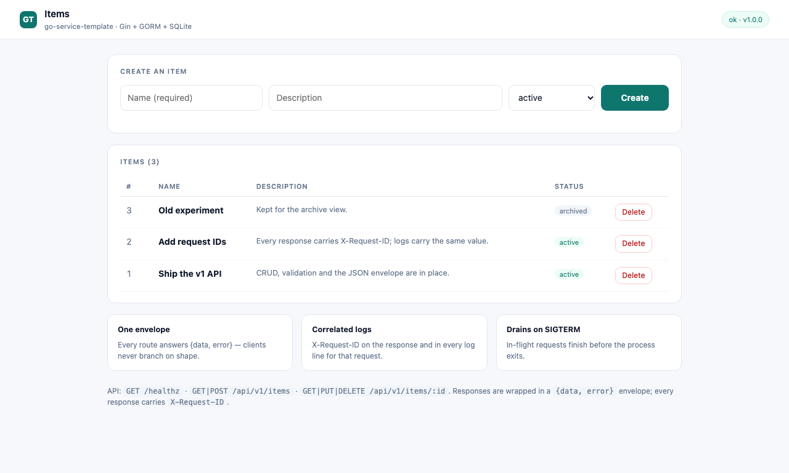
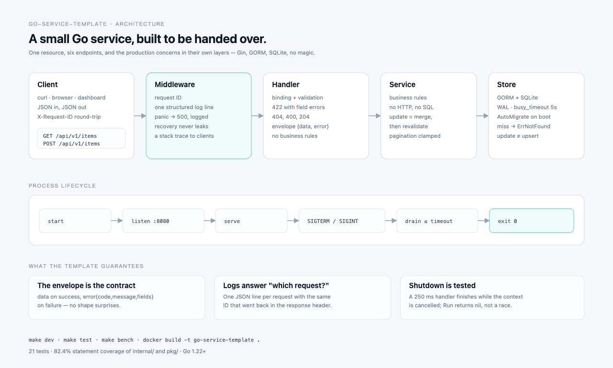
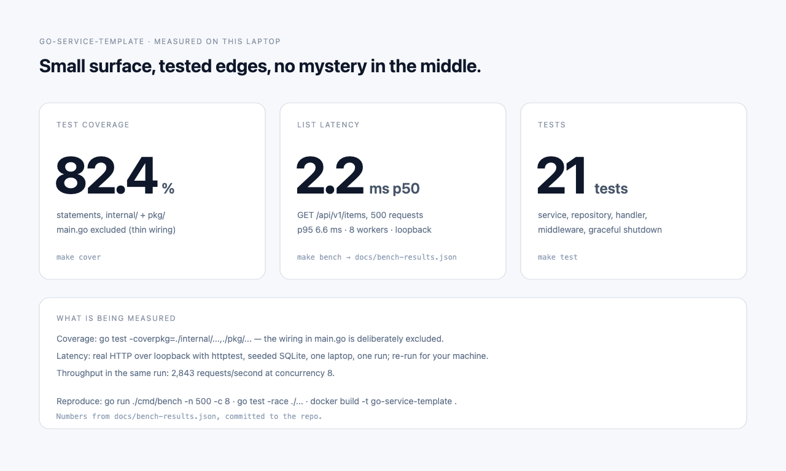

# go-service-template

A small, complete Go HTTP service you can hand to a team: one resource, six endpoints, and the
boring production concerns already in their own layers. Gin for routing, GORM + SQLite for
persistence, `log/slog` for structured logs, and a graceful shutdown that is covered by a test.

The dashboard is served by the service itself — no separate frontend to keep in sync.



## What is in the box

- **Layered, not clever** — `handler` speaks HTTP, `service` owns rules, `repository` owns SQL.
  Nothing leaks across the boundaries; the service layer has no `gin.Context`.
- **One JSON envelope** — `{data}` on success, `{error: {code, message, fields}}` on failure.
  Validation failures are 422 with per-field messages.
- **Correlated logs** — every request gets an `X-Request-ID` (accepted from the caller or
  generated), returned in the header and written on every log line for that request.
- **Graceful shutdown** — `SIGINT`/`SIGTERM` stops accepting connections and drains in-flight
  requests for at most `SHUTDOWN_TIMEOUT`. A test holds a request open for 250 ms and asserts it
  completes while the context is cancelled.
- **Real tests** — 21 tests across service, repository, handler, envelope and lifecycle, with
  `-race` in CI.
- **Dockerfile + CI** — multi-stage build, non-root user, healthcheck, GitHub Actions running
  vet, race tests, coverage and build.

## Architecture



## Quick start

```bash
make dev                      # seed demo rows and serve http://127.0.0.1:8080
```

Open <http://127.0.0.1:8080> for the dashboard, or hit the API:

```bash
curl -s localhost:8080/healthz
curl -s -X POST localhost:8080/api/v1/items \
  -H 'Content-Type: application/json' \
  -d '{"name":"Review the PR","description":"small and complete"}'
curl -s "localhost:8080/api/v1/items?limit=10"
```

Docker:

```bash
docker build -t go-service-template .
docker run --rm -p 8080:8080 -e SEED_DEMO=true go-service-template
```

Other targets:

```bash
make test     # go test ./...
make cover    # coverage of internal/ + pkg/
make bench    # 500 requests, concurrency 8 → docs/bench-results.json
make docker-build
```

## API

| Method | Path | Notes |
|---|---|---|
| `GET` | `/healthz` | `{data:{status,version}}` |
| `GET` | `/` | dashboard (server-rendered, no build step) |
| `POST` | `/api/v1/items` | `{name, description?, status?}` → 201 |
| `GET` | `/api/v1/items` | `?limit=20&offset=0` → `{items,total,limit,offset}` |
| `GET` | `/api/v1/items/:id` | 404 when missing |
| `PUT` | `/api/v1/items/:id` | partial: only provided fields change |
| `DELETE` | `/api/v1/items/:id` | 204 |

Errors: `400 invalid_json` / `invalid_id`, `404 not_found`, `422 validation_failed` (with
`fields`), `500 internal_error`.

## Configuration

| Variable | Default | Notes |
|---|---|---|
| `HTTP_ADDR` | `:8080` | listen address |
| `DATABASE_PATH` | `app.db` | SQLite file; WAL and a 5 s busy timeout are applied |
| `LOG_LEVEL` | `INFO` | `DEBUG`, `INFO`, `WARN`, `ERROR` |
| `SHUTDOWN_TIMEOUT` | `10s` | accepts `10`, `10s`, `1500ms` |
| `SEED_DEMO` | `false` | insert three demo rows on an empty database |

## Measured

| Metric | Value | Reproduce |
|---|---|---|
| Statement coverage | **82.4%** of `internal/` + `pkg/` | `make cover` |
| List latency | **2.2 ms p50 · 6.6 ms p95** (500 requests, 8 workers, loopback) | `make bench` |
| Tests | **21**, including the shutdown drain test | `make test` |

Latency is one run on a laptop, not a load-test rig. The command is in `docs/bench-results.json`;
re-run it on your own hardware before quoting it.



## Layout

```
cmd/server      wiring only: config → db → repository → service → handler → router → server
cmd/bench       loopback benchmark for the list endpoint
internal/
  config        env parsing with defaults and validation
  database      SQLite open, pragmas, AutoMigrate, demo seed
  model         Item and its status constants
  repository    ItemStore interface + GORM implementation
  service       business rules, validation errors, pagination clamp
  handler       HTTP binding, status codes, dashboard page
  router        routes and middleware (request ID, access log, panic recovery)
  server        listen / serve / drain lifecycle
pkg/
  logger        slog JSON logger
  response      the one JSON envelope
docs/           architecture, metrics, screenshot (1280×769)
```

## Trade-offs, stated

- **SQLite, not Postgres.** Fine for a template and for single-node tools; swap
  `internal/database` + the GORM driver when you need concurrency at scale.
- **GORM, not sqlc.** Faster to read, easier to hand over; if you want compile-time SQL checks,
  the repository interface is the seam to replace.
- **No auth.** Add it at the router (middleware) and keep it out of handlers.
- **No migrations directory.** `AutoMigrate` is honest for v1; move to versioned migrations the
  moment two people deploy different versions.
- **Not a framework.** Delete `model.Item` and the item routes, keep the wiring.

MIT licensed.
